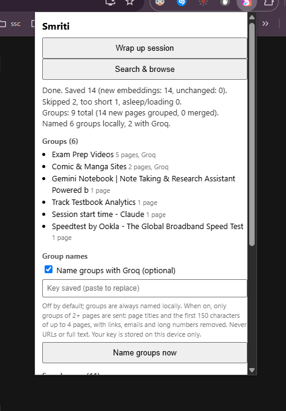
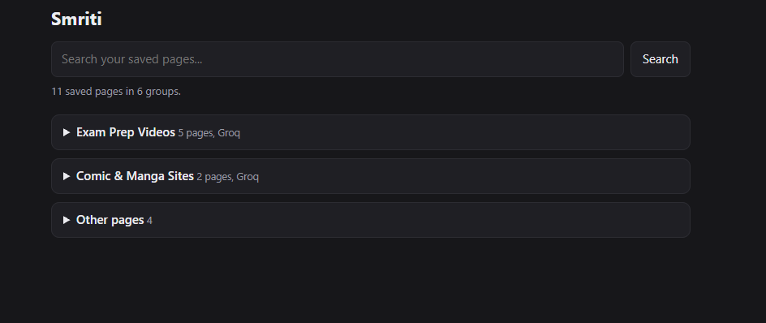
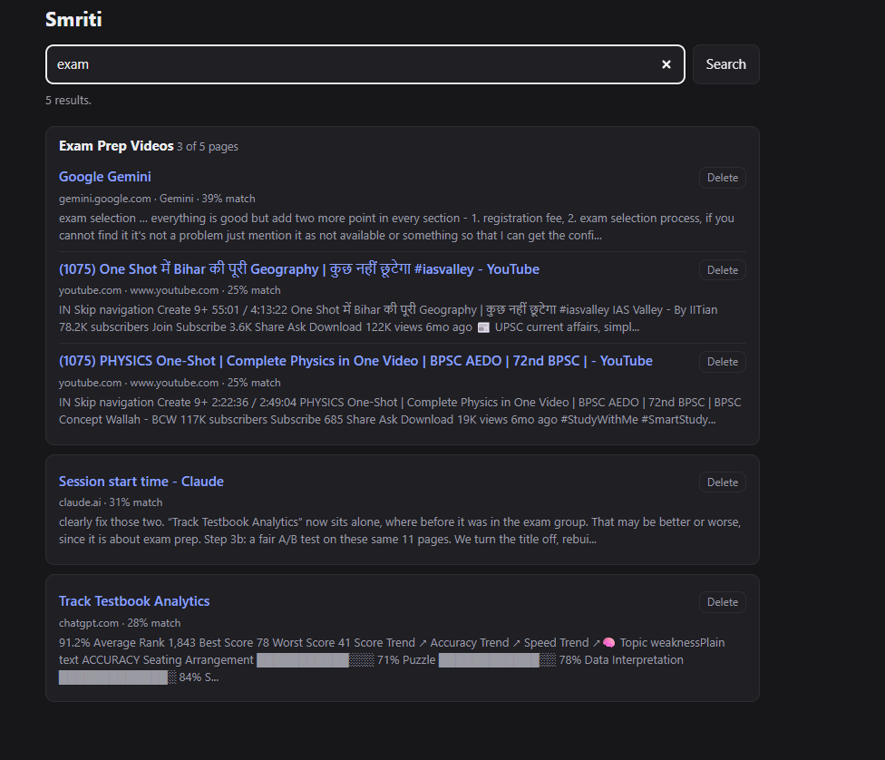

# Smriti — Your Browsing Memory

> *Smriti* (स्मृति) is Sanskrit for "memory."

A **local-first** Chrome extension that turns your open tabs into a searchable personal knowledge base. It reads the pages you have open, embeds them **on your device**, groups related pages into topics, and lets you search them by meaning instead of by remembering which tab it was.

**Status: v0.1.0, feature-complete for v1.** Extraction, on-device embeddings, clustering, topic naming, and a search/browse view all work. See the [Roadmap](#roadmap).





## Why

Tab hoarding is a memory problem. You open twenty tabs across exam prep, a side project, and a rabbit hole about smart-contract security, and a week later you cannot find the one page you needed. Smriti groups what you read by topic, without sending your browsing to a server.

## How it works

1. **Wrap up session.** You click a button in the popup. Nothing runs in the background and nothing is captured automatically.
2. **Extract.** The extractor is injected into your open tabs on demand and pulls the readable text (Mozilla Readability, with a fallback to visible text for app-style pages). YouTube home, feed, and search-results pages are skipped by URL before anything is read.
3. **Embed.** Text is chunked and embedded into 384-dimension vectors by `all-MiniLM-L6-v2`, running in WebAssembly inside an offscreen document. The model ships with the extension and is loaded from local files.
4. **Cluster.** Each page becomes one vector (the mean of its chunks). Pages join the most similar existing topic if the similarity is at least 0.50, otherwise they start a new one. A second pass merges topics whose centroids score at least 0.52.
5. **Name.** Every topic gets a local label (the title of its most central page). Optionally, topics with 2+ pages can be named by Groq (see [Privacy](#privacy)).
6. **Store and search.** Pages, chunks, and topics are saved in IndexedDB in your browser profile. The **Search & browse** view finds pages by keyword as you type, and by meaning when you press Enter. The search query is embedded on your device too.

## Privacy

Privacy is the point of this project, so here is exactly what happens:

- **Page content is processed and stored locally.** Extraction, embedding, clustering, search, and storage all run on your machine. The embedding model is bundled, with no runtime CDN or model download.
- **Nothing is captured until you click "Wrap up session."** There are no content scripts in the manifest. The extractor is injected on demand only into tabs you have open at that moment.
- **Host access is requested at runtime.** `<all_urls>` is an *optional* permission, requested when you first click wrap-up.
- **Incognito tabs are never read.** Only http(s) pages are processed. Sleeping tabs are skipped, never reloaded.
- **Search sends nothing anywhere.** Your query is embedded locally.
- **Optional cloud naming (off by default).** If you turn it on and add your own Groq API key, topics with 2+ pages are named by a Groq model. For each topic, only the titles and the first 150 characters of up to 4 pages are sent, with links, emails, and long numbers removed and topics numbered 1..n. No URLs, no full page text, no database IDs. Singletons are never sent. The `api.groq.com` permission is requested only when you turn the toggle on. Without it, everything still works with local labels.
- **Your Groq key is stored unencrypted** in `chrome.storage.local` on your device, readable only by this extension. Chrome has no secure vault for extensions. You can revoke the key at any time in the Groq console.
- **You can delete everything.** "Delete all my data" in the popup removes all saved pages, chunks, and topics. Individual pages can be deleted from the search view.

## Tech highlights

- **On-device ML under Manifest V3.** transformers.js runs in an offscreen document to survive service-worker shutdown. The document is shared by wrap-up and search through a reference count, with a warm window after a search and cleanup of orphans left by a killed worker.
- **Serialized inference with time limits.** One embedding batch runs at a time, and every long step has a timeout, so a hang becomes a readable error instead of a wedged extension.
- **Data-driven clustering.** The two thresholds were chosen from measured similarity distributions on real browsing data. Page-level matching beat chunk-level matching, which produced false matches from generic boilerplate chunks. A merge pass fixes centroid dilution.
- **Hybrid search.** Instant keyword matching while typing, semantic ranking on Enter. Pages are ranked by their page vector; the best-matching chunk is used only as the snippet. The score threshold was validated on real queries.
- **Extraction heuristic found from real data.** Readability output is accepted only if it covers at least 30% of the page's visible text, which fixes partial extraction on app-style pages.
- **Privacy-minimizing cloud step.** Local-first fallback, data minimization, scrubbing, anonymized group IDs, a runtime-granted permission, and treating page text as untrusted input to the model (validated output, rendered with `textContent` only).
- **Resilient wrap-up.** Progress and results live in `chrome.storage.local`, so the popup can close mid-run (MV3 popups die on focus loss) and still show status. A clustering or naming failure never loses extraction or embedding work.
- **Compact storage.** Vectors are stored as `Float32Array` and L2-normalized, so cosine similarity is a plain dot product. Chunk replacement and page deletion are transactional.

## Setup (from source)

Requires Node.js and Chrome.

```bash
git clone https://github.com/rishav1729/Smriti.git
cd Smriti
npm install
npm run download-model   # one-time, dev-time download of MiniLM into models/
npm run build            # bundles the offscreen script, copies WASM into vendor/
```

Then open `chrome://extensions`, enable **Developer mode**, click **Load unpacked**, and select the project folder.

Re-run `npm run build` after editing `offscreen/offscreen.js`. Edits to other files only need an extension reload.

## Usage

1. Open some tabs.
2. Click the Smriti toolbar icon and press **Wrap up session**.
3. Grant site access when prompted (first run only).
4. Watch progress in the popup. When it finishes, the summary shows how many pages were saved, embedded, and grouped.
5. Press **Search & browse** to open the full-page view. Type to filter by title, URL, or site; press Enter to search by meaning. Groups of related pages are listed below, and each result has a Delete button.
6. *(Optional)* In the popup, tick **Name groups with Groq**, paste your key, and press **Name groups now**.

## Project structure

```
background/service-worker.js   orchestrates wrap-up, search, delete
content/extractor.js           on-demand page text extraction
offscreen/                     hidden page that runs the embedding model
graph-view/                    full-page search and browse view
lib/storage.js                 IndexedDB wrapper
lib/embeddings.js              chunking + embedding API
lib/clustering.js              page vectors, assignment, merge pass
lib/search.js                  semantic search over pages
lib/summarizer.js              topic labels (local, optional Groq)
lib/readability.js             vendored Mozilla Readability
popup/                         toolbar popup UI
```

Full design notes and decisions are in [ARCHITECTURE.md](ARCHITECTURE.md).

## Roadmap

- [x] Manual wrap-up from the popup
- [x] On-demand content extraction
- [x] Local embeddings (MiniLM, WASM)
- [x] Similarity clustering into topics
- [x] IndexedDB storage
- [x] Topic labels and summaries (local, optional Groq)
- [x] Search and browse view with page deletion
- [x] Delete all data
- [ ] Re-grouping of changed pages
- [x] Skip YouTube home/feed pages and drop lone search-result pages
- [ ] More low-value page rules

**Later:** related-content nudge on new pages, visual graph view, duplicate-tab detection, capturing tabs closed before wrap-up.

## Known limitations

- Pages with very little text (login screens, app shells) group poorly.
- YouTube home, feed, and search-results pages are skipped before reading. Google, Bing, and DuckDuckGo search pages are kept only if they group with a real page, and are otherwise dropped after grouping. A search whose related tabs are not open yet is dropped too.
- Groq's free tier allows about 8,000 tokens per minute. With many topics, cloud naming can stop on a rate limit (429). The remaining topics keep their local labels and are retried on the next run.
- Very long pages are capped at 60 chunks, so the tail is not embedded.
- Changed pages are not automatically re-grouped yet.
- A topic's name can change when its pages change, and a cloud model may word it differently.
- Only open tabs are captured. Tabs closed before wrap-up are not.

## Credits

- [transformers.js](https://github.com/huggingface/transformers.js) (Apache-2.0)
- [onnxruntime-web](https://github.com/microsoft/onnxruntime) (MIT)
- [all-MiniLM-L6-v2](https://huggingface.co/sentence-transformers/all-MiniLM-L6-v2) (Apache-2.0), quantized ONNX build by [Xenova](https://huggingface.co/Xenova/all-MiniLM-L6-v2)
- [Mozilla Readability](https://github.com/mozilla/readability) (Apache-2.0)

## License

[MIT](LICENSE) © 2026 Rishav. The vendored Mozilla Readability (`lib/readability.js`) remains under its own Apache-2.0 license, and its header is kept in the file.